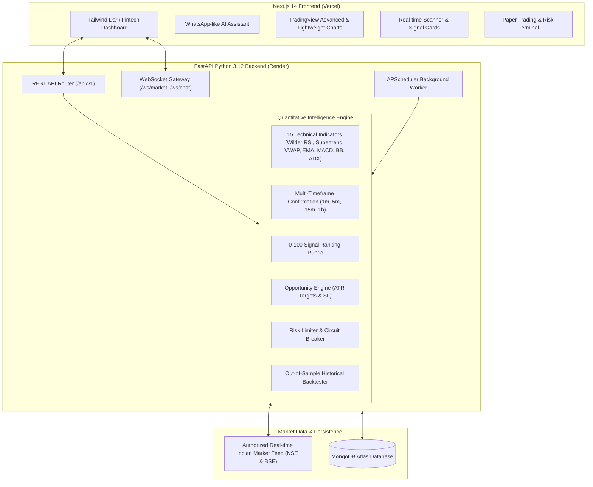

# Trade Bot AI — Advanced Indian Stock Market Analysis & Quantitative Trading Platform

> **Production-Ready AI-Powered Indian Stock Market Analysis & Quantitative Trading Platform**  
> *Combining an Intelligent AI Trading Assistant, WhatsApp/ChatGPT-style Chat Interface, Professional Financial Dashboard, Interactive TradingView Charts, Automatic NSE Market Scanner, Multi-Timeframe Scoring, Virtual Paper Trading, and Strategy Backtesting.*

---

## 🏛 System Architecture



---

## 🚀 Key Features

### 1. Intelligent AI Trading Assistant (WhatsApp & ChatGPT Inspired)
- Split-pane conversation history, search, and message timeline.
- Supported natural language and commands:
  - `TOP 5`: Shows highest-scoring confirmed setups.
  - `ANALYZE <SYMBOL>`: E.g., `ANALYZE RELIANCE` delivers full multi-timeframe indicator breakdown.
  - `SCAN`: Initiates real-time scan of eligible NSE equities.
  - `STATUS`: Indian market status (Open/Closed), IST time, advance-decline ratio, and key indices.
  - `ADD <SYM>` / `REMOVE <SYM>` / `LIST`: Watchlist management.
  - Natural queries: *"Find today's best intraday opportunities"*, *"Which stocks have bearish momentum?"*, *"Calculate my position size"*.
- Interactive **Trading Signal Cards** and **Stock Analysis Cards** rendered inline.

### 2. Market Overview Dashboard
- Genuine real-time quotes for **NIFTY 50**, **BANK NIFTY**, and **SENSEX**.
- Advance / Decline market breadth ratio.
- Top Gainers, Top Losers, and Volume Shockers (>1.8x 20-day MA volume).
- Dynamic data status badges: `LIVE`, `DELAYED`, `OFFLINE` with Indian Standard Time (IST) sync timestamps.

### 3. Dual TradingView Chart Integration
- **TradingView Advanced Widget**: Embedded real-time candlestick charts with NSE/BSE symbols, multi-timeframe switching, drawing tools, and study overlays (EMA, VWAP, RSI, MACD).
- **TradingView Lightweight Charts**: Custom local candlestick & volume charts using genuine OHLCV data.

### 4. Personal Watchlist Engine
- Persistent watchlist stored in MongoDB Atlas with resilient local fallback.
- Real-time indicator monitoring (LTP, % Change, Volume, RSI, VWAP, Supertrend status).
- One-click deep analysis and chart launching.

### 5. Automatic Background NSE Market Scanner
- Background engine scanning the NSE universe.
- Filters:
  - Top 5 BUY Opportunities
  - Top 5 SELL Opportunities
  - Bullish Breakouts (20-period highs + volume confirmation)
  - Bearish Breakdowns (20-period lows + volume surge)
  - Unusual Volume surges (>= 1.8x 20-MA)
  - Strong Trend Momentum (ADX > 25 with RSI confirmation)

### 6. Mathematical 0–100 Setup Scoring Engine
*Adhering strictly to the specified quantitative weighting:*

| Parameter | Score Weight | Quantitative Criteria |
| :--- | :---: | :--- |
| **Trend Confirmation** | 20 | EMA alignment (9 > 20 > 50), Price > SMA 200, Supertrend direction |
| **Volume Confirmation** | 20 | Volume ratio >= 1.5x to 2.0x 20-period volume average |
| **RSI Momentum** | 10 | 55–70 for Bullish; 30–45 for Bearish momentum |
| **VWAP Confirmation** | 10 | Price above VWAP (Long) / below VWAP (Short) |
| **MACD Confirmation** | 10 | MACD line above Signal line with positive histogram expansion |
| **Price Action** | 15 | Range breakout/breakdown & Candlestick patterns (Engulfing, Hammer, Shooting Star) |
| **Multi-Timeframe Confirmation** | 10 | 5m trigger aligned with 15m/1h higher trend direction |
| **Risk / Reward Quality** | 5 | R:R ratio >= 1:2.0 based on ATR targets |
| **Total** | **100** | **Classifications: 90–100 (Excellent), 80–89 (Strong), 70–79 (Moderate), < 70 (No alert)** |

> **Strict Rule:** No setup below 70 score generates an alert. *Accuracy over quantity; capital protection first.*

### 7. Opportunity Engine & Interactive Signal Cards
Calculates exact:
- Entry price
- Stop-loss (ATR-based volatility buffer)
- Target 1 (1:1.5 R:R)
- Target 2 (1:2.5 R:R)
- Target 3 (1:4.0 R:R)
- Position size based on user risk tolerance (e.g. 1% capital)
- Max holding period (Intraday square-off before 15:15 IST)
- Quantitative rationale explaining every generated signal.

### 8. Virtual Paper Trading Terminal
- Initial capital: **₹10,00,000 INR** (Virtual).
- Real-time order execution with live NSE prices.
- Live mark-to-market (MTM) unrealized and realized P&L calculation.
- One-click paper execution directly from AI signal cards.
- *Strictly labeled as PAPER TRADING. No broker credentials required or accepted.*

### 9. Risk Management & Circuit Breakers
- Position sizing calculator: `Quantity = (Capital * Risk%) / |Entry - StopLoss|`.
- Indian statutory & brokerage cost estimation:
  - Brokerage: ₹20 flat or 0.05%
  - STT: 0.025% on sell side
  - NSE Exchange Turnover: 0.00325%
  - GST: 18% on fees
  - SEBI & Stamp duty
  - Slippage model (0.05%)
- Daily maximum loss limit (₹20,000 default) with automatic **Daily Trading Halt Circuit Breaker**.

### 10. Strategy Backtesting Engine
- Backtests algorithms over historical OHLCV data.
- Built-in strategies:
  1. `EMA_CROSSOVER_RSI`
  2. `SUPERTREND_BREAKOUT`
  3. `VWAP_PULLBACK`
- Prevents look-ahead and survivorship bias (simulates entry on next candle open).
- **Out-of-sample testing split:** Evaluates 70% in-sample and 30% out-of-sample data to prevent overfitting.
- Metrics: Win Rate %, Profit Factor, Max Drawdown %, Net P&L after all Indian statutory taxes & slippage.

---

## 💻 Tech Stack

- **Frontend**: Next.js 14 (App Router), React 18, TypeScript, Tailwind CSS, Lucide React, TradingView Widgets, TradingView Lightweight Charts, WebSockets.
- **Backend**: Python 3.12, FastAPI, Pandas, NumPy, yfinance, Motor / PyMongo, APScheduler, WebSockets, Python-Jose.
- **Database**: MongoDB Atlas.
- **Deployment**: Vercel (Frontend), Render (Backend), GitHub.

---

## 🛠 Local Setup & Running

### 1. Backend Setup
```bash
cd backend
python -m venv venv
# On Windows:
.\venv\Scripts\activate
# On Linux/macOS:
source venv/bin/activate

pip install -r requirements.txt
cp .env.example .env

# Run FastAPI Server
uvicorn app.main:app --host 0.0.0.0 --port 8000 --reload
```
API Documentation will be live at `http://localhost:8000/docs`.

### 2. Frontend Setup
```bash
cd frontend
npm install
cp .env.example .env.local

# Run Next.js Dev Server
npm run dev
```
Open `http://localhost:3000` in your browser.

---

## 🌐 Production Deployment

### Backend on Render
1. Connect your GitHub repository to Render.
2. Select **Web Service** using `render.yaml` or Docker environment.
3. Set environment variables:
   - `MONGODB_URI`: Your MongoDB Atlas connection URI.
   - `DATABASE_NAME`: `tradebot_db`
   - `SECRET_KEY`: Secure random string.
   - `SCANNER_INTERVAL_SECONDS`: `60`
4. Build command: `pip install -r requirements.txt`
5. Start command: `uvicorn app.main:app --host 0.0.0.0 --port $PORT`

### Frontend on Vercel
1. Import the repository on Vercel.
2. Root Directory: `frontend`
3. Framework Preset: `Next.js`
4. Set Environment Variables:
   - `NEXT_PUBLIC_API_URL`: `https://your-backend.onrender.com`
   - `NEXT_PUBLIC_WS_URL`: `wss://your-backend.onrender.com`
5. Deploy.
